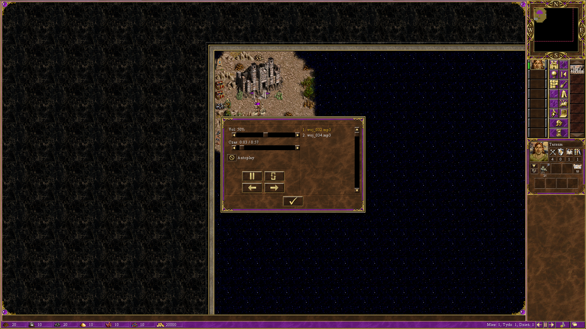

# H3ButtonPlugin

Plugin (DLL) do Heroes of Might and Magic III (HD Mod / H3API), dodający pasek narzędzi na mapie przygody
do sterowania odtwarzaniem audio (Play/Pauza/Next/Previous/Menu) oraz automatyczne odtwarzanie narracji
ElevenLabs wykrywanej po treści okien dialogowych kampanii.

## Podgląd



Przykładowy wygenerowany fragment narracji (kampania "Wojownicy Pustkowi"): [docs/sample-audio/woj_032.mp3](docs/sample-audio/woj_032.mp3)

## Odtworzenie na nowym komputerze

Sprawdzone 2026-11-05 na świeżym klonie z GitHuba (build bez błędów, komplet 1613 plików audio).
Wszystko, czego projekt potrzebuje, jest w tym repo, jego submodułach i publicznym repo H3Plugins:

```
mkdir plugin
cd plugin
git clone --recurse-submodules https://github.com/Nossi201/H3AudioNarrator.git H3ButtonPlugin
git clone https://github.com/RoseKavalier/H3Plugins.git
cd H3ButtonPlugin
cmake -B build -A Win32
cmake --build build --config Release
```

Najwygodniej odtworzyć ten sam układ katalogów co wcześniej:
`F:\gry\h3-Chro-Hdmod(modowanie)\plugin\H3ButtonPlugin` i `...\plugin\H3Plugins`, a gry
`HoMM 3 Complete*` w `F:\gry\h3-Chro-Hdmod(modowanie)\`. Wtedy `deploy.ps1` działa bez zmian.
Przy innym układzie popraw w nim `$pluginRoot` i `$parentDir`.

Czego w repo NIE ma (trzeba mieć osobno):
- **samej gry** z HD Modem i plikami `.exe` kampanii Heroes Chronicles;
- **rejestracji paczki w HD Launcherze** (zapisuje się w `_HD3_Data\Settings\sod.ini` gry) — po
  `deploy.ps1` dodaj wybraną paczkę `TextDetector*` w launcherze (patrz „Deploy do gry”);
- **klucza ElevenLabs** — potrzebny tylko do generowania nowego audio (zmienna `ELEVENLABS_API_KEY`).

## Wymagania

- Visual Studio z obsługą C++ i CMake (testowane z instalacją w `C:\Program Files\Microsoft Visual Studio\18\Community`)
- CMake 3.20+
- Sąsiedni checkout [RoseKavalier/H3Plugins](https://github.com/RoseKavalier/H3Plugins) — patrz niżej

## Zależności zewnętrzne

- **`external/H3API`** — git submodule ([RoseKavalier/H3API](https://github.com/RoseKavalier/H3API)). Po sklonowaniu:
  ```
  git submodule update --init
  ```
  (albo `git clone --recurse-submodules` od razu).
- **`external/miniaudio`** — wendorowany single-header (`miniaudio.h`), zwykłe pliki repo, nic do inicjalizacji.
- **`tools/chronicles_voiceover`** — git submodule ([Nossi201/H3-VoiceOver-Pack](https://github.com/Nossi201/H3-VoiceOver-Pack)),
  wyekstrahowane teksty i wygenerowane audio narracji kampanii Heroes Chronicles. Opcjonalny — plugin buduje się
  i działa bez tego (to tylko dane runtime dla auto-play narracji). Inicjalizacja: `git submodule update --init tools/chronicles_voiceover`.
- **`../H3Plugins`** — **NIE jest submodułem tego repo**, musi być sklonowany osobno jako katalog siostrzany
  (`plugin/H3Plugins` obok `plugin/H3ButtonPlugin`):
  ```
  git clone https://github.com/RoseKavalier/H3Plugins.git
  ```
  `CMakeLists.txt` czyta stamtąd `H3API/lib` (starsze `Plugin.hpp`/`patcher_x86.hpp`, na których bazuje
  `src/Plugin_local.cpp`) oraz `ThirdParty/` (`json.hpp`, `stb_image.h`, `stb_image_resize.h`, `INIReader.h`,
  `era.hpp`). Domyślnie `H3PLUGINS_DIR` wskazuje na katalog siostrzani (`../H3Plugins`); jeśli trzymasz go
  gdzie indziej, nadpisz przy konfiguracji: `cmake -B build -DH3PLUGINS_DIR=C:/sciezka/do/H3Plugins`.

## Build

CMake re-konfiguruje się automatycznie przy zmianie `CMakeLists.txt`, więc zwykle wystarczy:
```
cmake --build build --config Release
```
Wynik: `build\bin\Release\H3ButtonPlugin.dll`.

## Deploy do gry

`build_deploy.bat` (build + `deploy.ps1`) kopiuje DLL i `text_map_with_filter.txt` do zainstalowanych kopii
gry. **Ścieżki w `deploy.ps1` są wpisane na sztywno** (`$pluginRoot`, foldery `_HD3_Data\Packs\...`) —
dostosuj je do swojego układu katalogów przed użyciem.

Każda z 8 kampanii Heroes Chronicles może mieć własną, samodzielną paczkę:

```
.\deploy.ps1                  # Woj -> Packs\TextDetector\ (tryb historyczny)
.\deploy.ps1 -Campaign Pod    # Pod -> Packs\TextDetector - Podboj Podziemi\
.\deploy.ps1 -Campaign All    # wszystkie 8 kampanii, każda we własnym folderze
```

Kody: `Bun`, `Drz`, `Mie`, `Ogn`, `Pod`, `Sza`, `Wla`, `Woj`. W HD Launcherze rejestruj naraz tylko
jedną paczkę `TextDetector*`. DLL w każdej paczce ma zawsze nazwę `H3ButtonPlugin.dll` (przemianowany
przestaje działać). Skrypt bierze build Release; Debug tylko z `-AllowDebug`.

Każda paczka potrzebuje też **`TD.lod`** (grafiki przycisków paska i okna F6) oraz **`H3.LodTable.dll`**
(z [H3Plugins](https://github.com/RoseKavalier/H3Plugins), licencja MIT). Oba pliki są w `pack_assets\`
i `deploy.ps1` sam je kopiuje do każdej paczki.

Samo skopiowanie plików do `_HD3_Data\Packs\TextDetector\` nie wystarczy — trzeba jeszcze zarejestrować
paczkę w **HD Launcherze**: Ustawienia główne → Dodatkowe paczki danych → Dodaj → wybierz folder `TextDetector`.

## tools/ — generowanie audio (Python)

Skrypty w `tools/` wyciągają teksty kampanii z plików gry i generują do nich narrację przez ElevenLabs API.
Zależności: `pip install -r tools/requirements.txt` (Pillow, elevenlabs).

Wymagają zmiennej środowiskowej:
```
setx ELEVENLABS_API_KEY "twoj-klucz"
```
(albo ustaw ją w bieżącej sesji przed uruchomieniem skryptu). Bez tego skrypty generujące audio
(`generate_dialogue.py`, `generate_mixed_audio.py`, `generate_woj_campaign.py`) zakończą się błędem.
